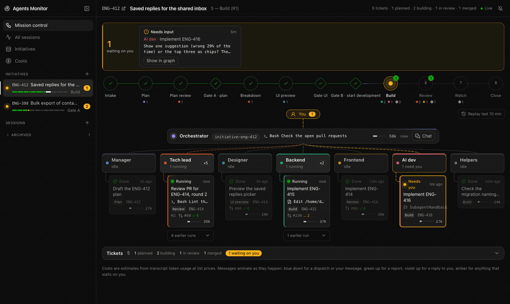
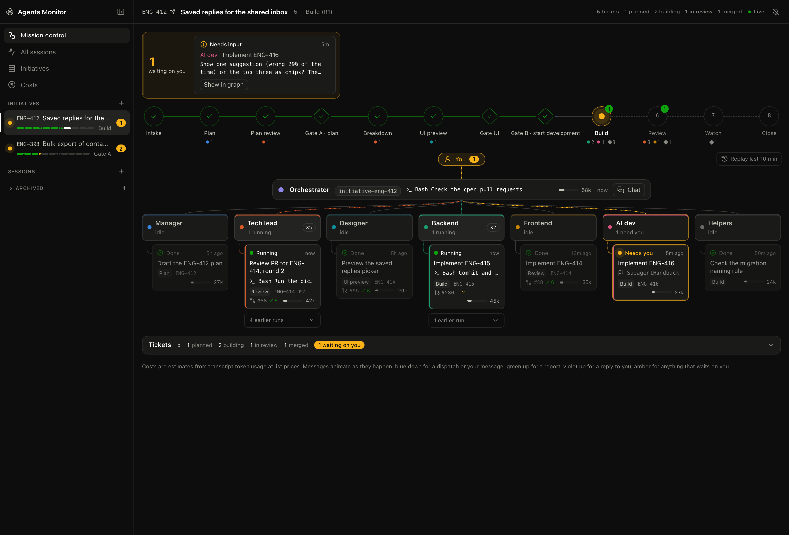
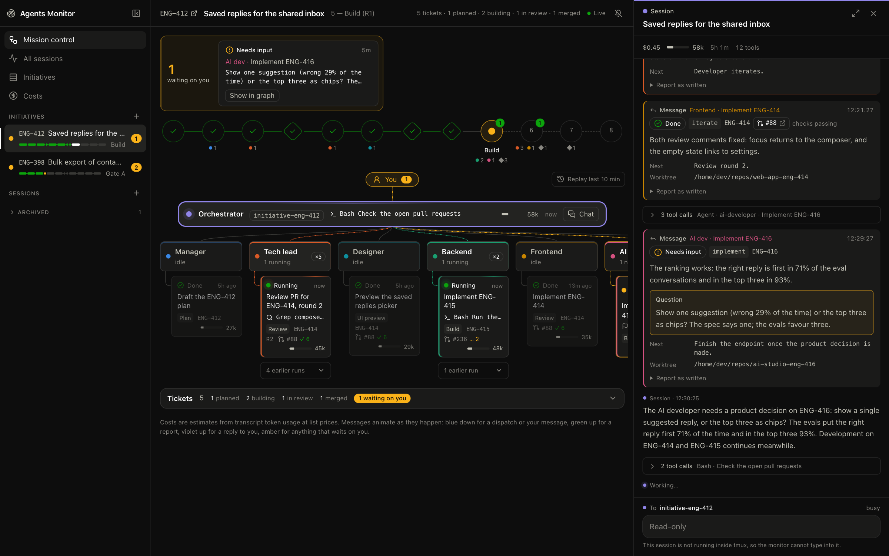
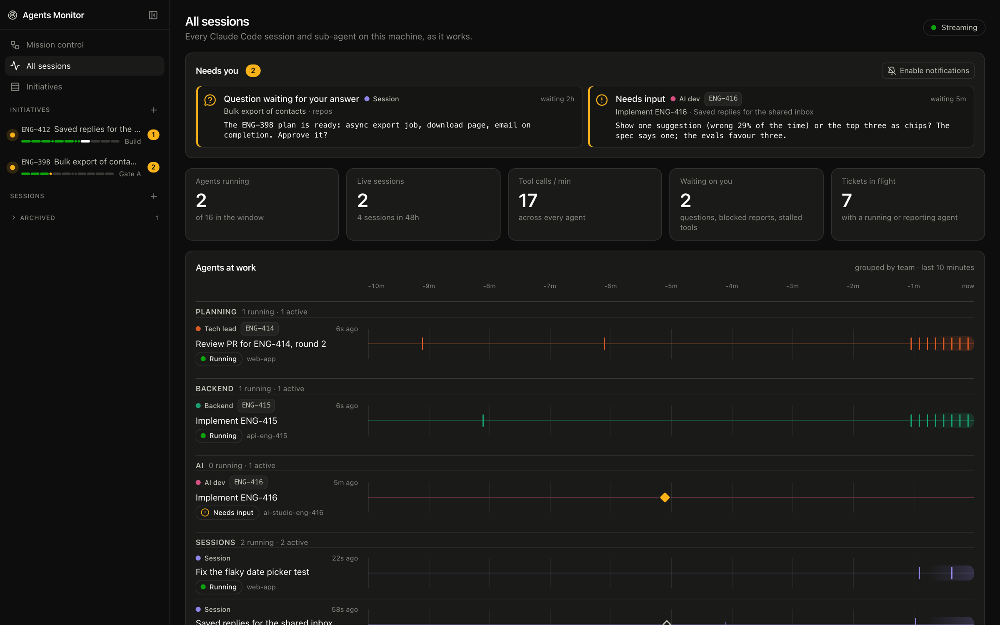
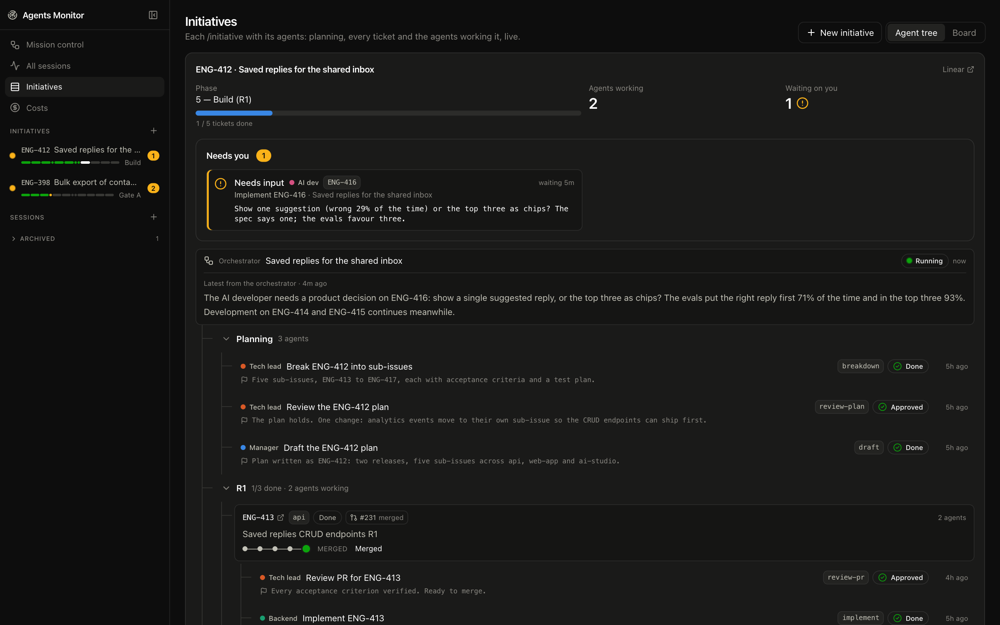
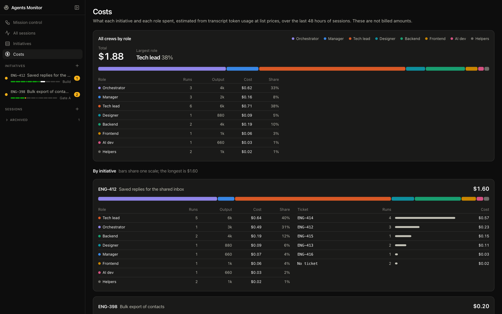

# agents-monitor

Local mission control for the Claude Code sessions and sub-agents running on your machine, with a team of specialist agents (the `/initiative` dev team) as a first-class view.

It answers three questions at a glance: where is each initiative, who is working on it right now, and what is waiting on you.

Everything is read from the files Claude Code already writes under `~/.claude`.
There is no database, no hooks and no agent-side setup: start the server and the sessions that are already running show up.



## Demo

```bash
pnpm install
pnpm demo                    # http://127.0.0.1:4310
```

`pnpm demo` needs no Claude Code session, no Linear key and no GitHub login.
It generates a Claude home under `.demo/` for a fictional team: one initiative in the build phase with two runs working, one paused at a gate with a question open, one finished, and a plain session.
A ticker keeps appending tool calls to the live runs, so the graph, the feed and the costs move.
The recording above and the screenshots in this README are taken from it.

The data is written in the same format Claude Code uses and read by the same code as real data; only the issues and pull requests come from JSON files instead of Linear and GitHub.

## The team

The monitor watches a team of specialist agents that takes a requirement from idea to merged pull requests.
The team is run by the `/initiative` skill and defined in `~/.claude/agents/*.md`.
The prompts of the six roles and the skill are in [`team/`](team/), with the company-specific parts replaced by a fictional product; see [Using the team](#using-the-team).

One person sits at the top and makes every product decision.
One orchestrator session runs the process.
Six specialists do the work, each owning a single concern.

| Seat | Agent | Owns | Modes |
|---|---|---|---|
| You | — | Product decisions, the gates, the final merge | — |
| Orchestrator | The main Claude Code session | The process: launches agents, relays their reports, runs the gates, keeps the registry | — |
| Manager | `initiative-manager` | The **what and why**: the initiative plan, its sequencing across repos, its progress | `draft`, `revise`, `status` |
| Tech lead | `tech-lead` | The **how**: feasibility, the breakdown into sub-issues with a technical spec each, adversarial PR review | `review-plan`, `breakdown`, `review-pr` |
| Designer | `designer` | What the user **sees and touches**: a live, clickable UI preview built from the real components | `ui-preview`, `iterate`, `approve` |
| Backend | `backend-developer` | The API: implements a spec commit by commit in its own worktree, behind a draft PR | `implement`, `iterate`, `release` |
| Frontend | `frontend-developer` | The desktop and web apps, starting from the approved UI preview | `implement`, `iterate`, `release` |
| AI dev | `ai-developer` | The AI stack: generation, transcription, voice agents, MCP servers | `implement`, `iterate`, `release` |
| Helpers | `general-purpose`, `Explore` | Short supporting jobs: a broad code search, a rule check on a PR | — |

### How they work together

Agents cannot call each other, so **every hand-off goes through the orchestrator**.
That is why the hierarchy is a star around it, and why a message between two specialists is drawn travelling up to the orchestrator and back down.

Each role is deliberately narrow, and the roles check each other.
The manager writes the plan and the tech lead attacks it.
The designer settles the screen before a developer writes production code.
The tech lead that reviews a pull request is a fresh instance, independent from the one that wrote its spec.

An agent ends each run with a report: done, changes requested, needs input, or blocked.
A question an agent cannot answer is never answered on your behalf: it travels up to you, and shows in amber until you reply.

One instance is kept per job and reused, which is why a seat holds several runs over the life of an initiative: one designer per screen, one developer per sub-issue, one reviewer per pull request.

### The pipeline they follow

| # | Phase | Who | Outcome |
|---|---|---|---|
| 0 | Intake | Orchestrator | A requirement with a problem, an audience and a success measure |
| 1 | Plan | Manager | The initiative plan as a parent issue |
| 2 | Plan review | Tech lead | The plan validated against the codebase, in up to three rounds |
| | **Gate A · plan** | **You** | The plan approved |
| 3 | Breakdown | Tech lead | Sub-issues, each with a full technical spec |
| 4 | UI preview | Designer | A live preview per frontend sub-issue |
| | **Gate UI** | **You** | Each preview approved |
| | **Gate B · start dev** | **You** | The sub-issues to build, chosen |
| 5 | Build | Developers | A draft pull request per sub-issue, at most three developers at once |
| 6 | Review | Tech lead | Each pull request verified criterion by criterion, in up to four rounds |
| 7 | Watch | Orchestrator | Failing checks and human comments sent back to the developer |
| 8 | Close | Manager | Final status once every sub-issue is merged or dropped |

The three gates are the only points where the team stops and waits.
They are the amber diamonds on the pipeline.

### Using the team

`team/agents/` holds the six role prompts and `team/skills/initiative/` the orchestrator skill with its two scripts.
To run the team, copy them to `~/.claude/agents/` and `~/.claude/skills/initiative/`, and replace `team/skills/initiative/stack.md` with your own repositories and commands: it is the one file that describes a codebase, and the copy here describes an example.

The monitor depends on a few things those prompts make the agents write, so keep them when you edit:

| Convention | Where the monitor reads it |
|---|---|
| A launch prompt that starts with `MODE: <mode>` and names the ticket | The run's stage on the pipeline and its ticket |
| "round N" in a review prompt | The review round on the ticket |
| The hand-back block (`AGENT`, `MODE`, `STATUS`, `TICKET`, `PR`, `SUMMARY`, `QUESTIONS`, `NEXT`) | Done, changes requested, needs input or blocked |
| `~/.claude/initiatives/<KEY>/registry.md` with `Phase:`, `Parent:`, `## Log` and `## Live previews` | The initiative, its phase or gate, and its agents |
| Sub-issue titles that start with `[repository]` | Which repositories are searched for pull requests |

## Views

| View | Route | What it shows |
|---|---|---|
| Mission control | `/` | One crew at a time: its pipeline, its agent team as a live hierarchy, its tickets, and what waits on you |
| All sessions | `/live` | Every session and sub-agent on the machine: swim lanes of the last 10 minutes, an activity pulse by role, the parent → sub-agent tree and a filterable live feed |
| Initiatives | `/initiatives` | Each initiative registry with its phase and orchestrator log, its sub-issues as a board, their pull requests, and the agents on each ticket |
| Costs | `/costs` | What each initiative and each role spent: a bar per initiative split by role on one shared scale, with a table by role and by ticket |
| Agent | `/agents/<id>` | One agent's report, launch prompt and live stream: tool calls with results, Edit/Write diffs, messages. Thinking is never shown |



### Mission control

The page reads top to bottom.

1. **Waiting on you.** An amber band with one card per item: a question to answer, a PR to open, a gate to pass. When nothing waits, it shrinks to one line in the top bar.
2. **Pipeline.** The `/initiative` phases and gates as a strip of stations: Intake, Plan, Plan review, Gate A, Breakdown, UI preview, Gate UI, Gate B, Build, Review, Watch, Close. Each station carries its run and ticket counts. Clicking a station dims everyone not working in that stage.
3. **Agent team.** The hierarchy of the crew: You → Orchestrator → seats → runs → helper runs.
4. **Tickets.** Collapsed to one summary line with counts by state; expands to a chip per ticket.

A **left rail** lists initiatives and plain sessions, each with a status dot, a phase bar and a live or needs-you count.
A **details panel** opens beside the graph for an agent, the orchestrator or a ticket, without leaving the page.
Its widen button gives a conversation real room while the graph stays in view.

### Chat

The orchestrator, and any plain session, reads as a chat in the details panel: your prompts, the session's replies rendered as Markdown, tool calls folded into one row per burst that expands to input, result and diff, hand-backs from sub-agents marked with their sender, and an open question with its options.
Thinking is never shown.
The view follows the live tail while you are at the bottom and shows a "new messages" pill when you have scrolled up; "Load earlier messages" pages backwards through the transcript a window at a time.

It opens from the orchestrator bar's **Chat** button, from the chat icon on a rail row, or with `?chat=1` on the crew's URL.

The composer at the bottom names the session and tmux pane it types into.
Enter sends and Shift+Enter adds a line; the terminal takes one line, so line breaks are sent as spaces.
A message shows as sending, then is replaced by the prompt once it appears in the transcript, or shows why it was refused.
When the session cannot take a message (not in tmux, busy, or showing a question) the composer says why and stays disabled.

Sub-agents have no terminal of their own, so their conversation is read-only.
**Ask the orchestrator** opens the orchestrator's composer with a reference to that run, and the orchestrator forwards it.

| Key | Action |
|---|---|
| `[` | Collapse or expand the left rail |
| `Esc` | Close the details panel |

### The agent team

Seats are Manager, Tech lead, Designer, Backend, Frontend and AI dev, plus Helpers when the orchestrator spawned general-purpose runs.
A seat with no run stays visible, dashed and dimmed, so the shape of the team never changes.

Each seat shows up to three live or recent runs and a `×N` badge with its total.
The rest fold into "N earlier runs", which expands in place; each row opens the details panel or goes straight to the agent page.
Helper runs nest under the run that spawned them.

| State | How it looks |
|---|---|
| Running | Breathing green dot and a light sweeping along the card |
| Needs you | Amber pulse and outline |
| Waiting on a tool | Orange hourglass |
| Blocked | Red cross |
| Changes requested | Orange alert |
| Done | Green check |
| Idle | Moon, faded |

### Messages on the edges

Edges animate only when something happened, never as decoration.
Only events that arrive after the page loads are animated.

| Event | What moves |
|---|---|
| Orchestrator spawns or messages a run | Blue dot down the edge |
| A run reports or hands back | Dot up to the orchestrator: green when done, amber when it needs input, red when blocked |
| You prompt the orchestrator | Blue dot from You to the orchestrator |
| Orchestrator asks you a question | Amber dot up to You |
| Any other tool call | A brief flash on the node |

**Replay last 10 min** plays back the real messages of the last ten minutes, since live ones are easy to miss.

A message between sibling runs is drawn going up to the parent: transcripts name the target only as text, so the sideways path cannot be resolved.
All motion is disabled under `prefers-reduced-motion`.









## Architecture

### Reading Claude Code's files

| Source | Used for |
|---|---|
| `~/.claude/projects/<project>/<session>.jsonl` | Session title, branch, last prompt, activity, cost and context |
| `~/.claude/projects/<project>/<session>/subagents/agent-<id>.jsonl` + `.meta.json` | Sub-agent role, parent, depth, tool calls, `SubagentHandback` reports |
| `~/.claude/agents/*.md` | Each role's model, modes and mission: the seats of the team |
| `~/.claude/sessions/<pid>.json` | Which sessions are running, their status and tmux pane |
| `~/.claude/initiatives/<KEY>/registry.md` | Initiative phase, orchestrator log and its agent ids |

Transcripts reach hundreds of MB, so a file is only read from its head or its tail, and summaries are cached by mtime and size.
Token usage is folded forward from the last byte offset, so each byte is parsed once.
Live updates are server-sent events fed by polling file sizes every 1.5 seconds.
Costs are estimated from transcript token usage at list prices, not billed amounts.

The pipeline itself is not written in the monitor.
The phases and gates are parsed from the installed skill's `SKILL.md` (`## Phase N — name` headings and the lines that open with `Gate X`), so a phase or a gate added to the skill appears on the pipeline, in the rail and in the registry parser without a code change.
When no skill is installed the pipeline of the skill in `team/` is used, and a test keeps the two equal.

An agent is running when its transcript changed in the last 45 seconds, reported when its latest hand-back came after its latest prompt, and idle otherwise.

### Issues and pull requests

The Initiatives board joins each registry with its issues and their pull requests.

Issues come from Linear, through its GraphQL API with a personal API key.
The tracker sits behind one interface, `IssueTracker` in `src/lib/trackers/types.ts`, with a single method that returns a parent issue and its sub-issues.
Connecting Jira, GitHub Issues or another tracker means writing one module that returns that shape and selecting it in `src/lib/trackers/index.ts`; the comments in `types.ts` say how to map workflow states.

Pull requests and their checks come from GitHub through the local `gh` login, so the monitor holds no GitHub token.
They sit behind `PullRequestSource` in `src/lib/pull-requests/` the same way.

### Acting on a session

The monitor is read-only, with three exceptions.
Two act on a session already running inside tmux, one starts a new one, and each needs an explicit act from you.

- **Answer a waiting session.** An open `AskUserQuestion` or permission prompt is not in the transcript, so its question and options are read from the pane and offered as buttons; confirming types the matching keys. This keeps its confirmation dialog with the exact keys and the live pane.
- **Message an idle session.** Types the text and presses Enter. In the chat, pressing Enter in the composer is the confirmation: the composer names the target session and pane, and there is no second dialog.
- **Start a session or an initiative.** From the rail's `+` buttons or the Initiatives page. A session runs in one of the git checkouts directly under `AGENTS_MONITOR_REPOS` (worktrees are not offered); an initiative always runs in that folder itself, with `/initiative <requirement>`, `/initiative resume ENG-NNNN` or `/initiative status ENG-NNNN` as its first prompt. Before anything runs, the dialog shows the exact working directory and command, and you confirm it: `tmux new-session -d -s am-<name>-<hex> -c <dir> -- <claude> '<first prompt>'`. Claude starts with no flags. The new session shows in the rail as starting until Claude Code registers it, then opens in the chat.

A folder whose trust Claude has not accepted yet stops at Claude's trust dialog before reading the prompt, and the monitor cannot answer it; the dialog warns about those folders.

Nothing else is ever written: no comments on Linear or GitHub, no worktree touched, nothing under `~/.claude`, no initiative registry (the orchestrator writes that once it runs).

### Security

Transcripts contain full model output, file contents and tool results, so the server binds to `127.0.0.1` only.
Do not expose it through a tunnel or a reverse proxy.

All three actions are refused unless the request comes from this app's own page on a local host, and an answer is refused unless the same dialog is still on screen.

Starting a session (`POST /api/sessions`) accepts only `{kind: "session", target, prompt}` or `{kind: "initiative", mode, requirement | ticket}`. The target is a key the server maps to a directory it discovered itself; a path in the request is never used. The command is handed to `tmux` as an argument array, never through a shell, so the prompt is one untouched argument. The launch must echo the name its preview showed, so what runs is what you confirmed, and only one launch runs at a time until the previous one registers or 30 seconds pass.

In demo mode `POST /api/sessions` answers 403, and the other two actions have no tmux pane to type into.

## Stack

| Layer | Technology |
|---|---|
| App | Next.js 16 (App Router), React 19, TypeScript |
| Styling | Tailwind CSS 4, lucide-react icons |
| Live updates | Server-sent events over file polling |
| Issues | Linear GraphQL API |
| Pull requests | GitHub via the `gh` CLI |
| Terminal actions | tmux (`capture-pane`, `send-keys`, `new-session`) |
| Tests | Vitest, Playwright |
| Lint and format | Biome |
| CI | GitHub Actions: lint, typecheck, unit tests, build, and smoke tests over the demo |

## Project structure

```
src/
  app/                    — pages and API routes (snapshot, roster, initiatives, SSE streams, session actions)
  components/
    shell/                — app shell, left rail, shared data provider, launch dialog
    mission/              — pipeline track, team graph, details panel, tickets, attention band
    chat/                 — transcript as a conversation, composer
    live/, initiatives/, costs/, agent/, stream/ — the other views
  lib/
    config.ts             — every environment variable the server reads
    claude/               — server-only readers over ~/.claude: transcripts, sessions, roster, usage, tmux, launch
    trackers/             — IssueTracker interface, Linear, demo
    pull-requests/        — PullRequestSource interface, GitHub, demo
    pipeline-definition.ts — phases and gates, parsed from the skill
    registry.ts           — parser of an initiative registry
    initiatives.ts        — joins registries, issues and pull requests
    client/               — derived view models: pipeline, team hierarchy, attention items, costs
scripts/
  demo.mjs                — `pnpm demo`: generates the data, starts Next, keeps the live runs moving
  demo/scenario.mjs       — the fictional team and its initiatives
  demo/records.mjs        — builders for transcript lines
e2e/                      — Playwright smoke tests that run against `pnpm demo`
team/
  agents/                 — the six role prompts
  skills/initiative/      — the orchestrator skill, its stack file and scripts
docs/                     — screenshots
AGENTS.md                 — rules for contributors and coding agents
```

## Setup

Requirements: Node 20.9 or newer and pnpm 11.
For real data: Claude Code with at least one session on the machine.
`tmux` is needed only to answer, message or start a session, and the `gh` CLI only for pull-request data.

1. Install the dependencies.

   ```bash
   pnpm install
   ```

2. Create the environment file. Every variable is optional.

   ```bash
   cp .env.example .env.local
   ```

   | Variable | Purpose |
   |---|---|
   | `LINEAR_API_KEY` | Linear personal API key, used to read sub-issues and their states |
   | `GITHUB_OWNER` | GitHub user or organisation that owns the repositories named in sub-issue titles |
   | `TICKET_PREFIXES` | Ticket prefixes of your tracker (`ENG,OPS`). Without it anything shaped like `ABC-123` counts as a ticket |
   | `AGENTS_MONITOR_REPOS` | Parent folder of the checkouts a session may be started in; defaults to `~/work/repos` |
   | `AGENTS_MONITOR_CLAUDE` | The `claude` binary a launch runs; defaults to `~/.local/bin/claude` |
   | `CLAUDE_HOME` | Where Claude Code stores its data; defaults to `~/.claude` |

3. Start it.

   ```bash
   pnpm dev                     # http://127.0.0.1:4310
   ```

4. Run the checks.

   ```bash
   pnpm lint && pnpm typecheck && pnpm test && pnpm build
   ```

   The unit tests cover the transcript parser, the registry and pipeline parsers, the ticket pipeline, the cost model, the launch command and the request guard.
   One of them writes the demo data to a temporary folder and reads it back through the real readers.

5. Run the smoke tests. They build the app, start it in demo mode on port 4399 and open every view in a browser.

   ```bash
   pnpm exec playwright install chromium   # once
   pnpm test:e2e
   ```
